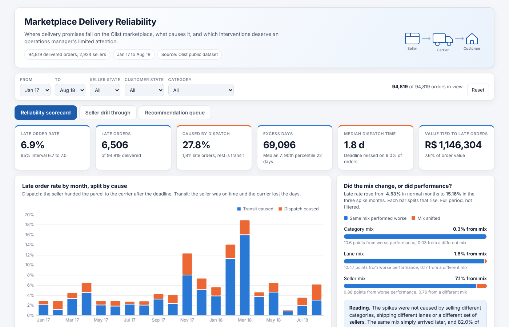
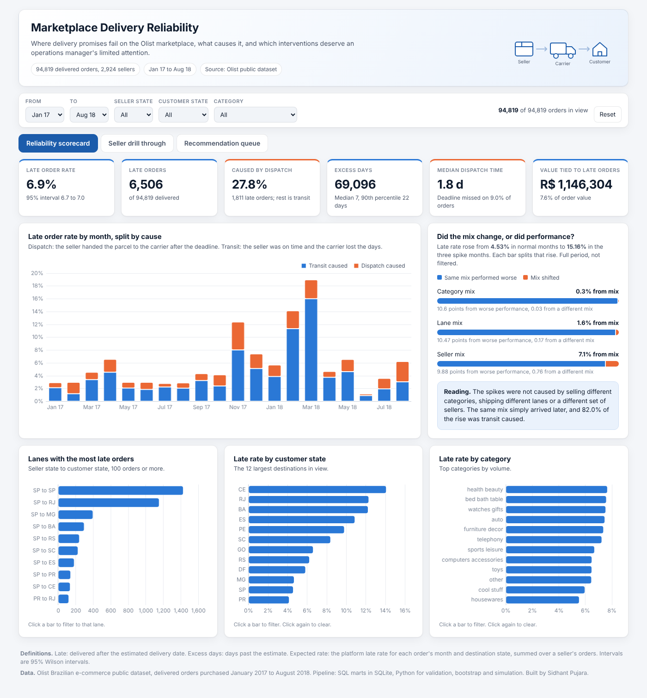
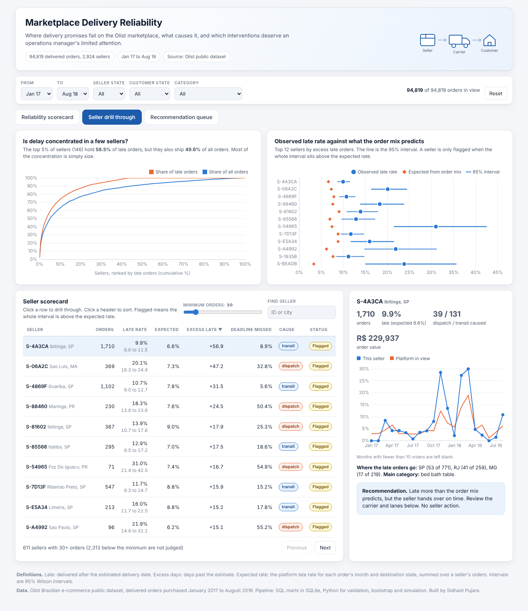
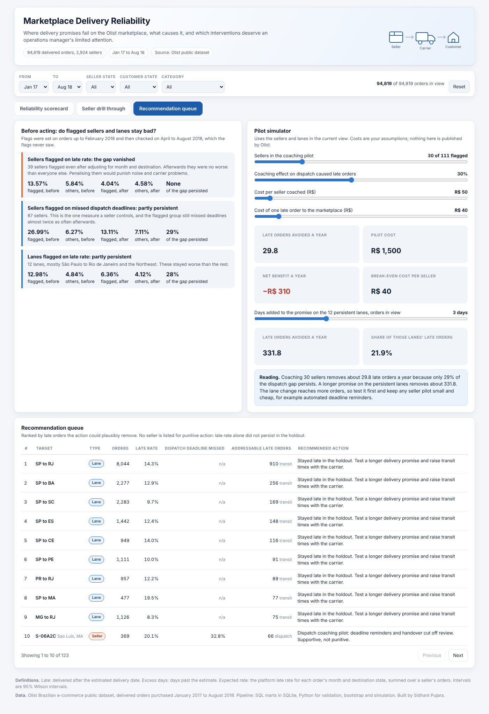
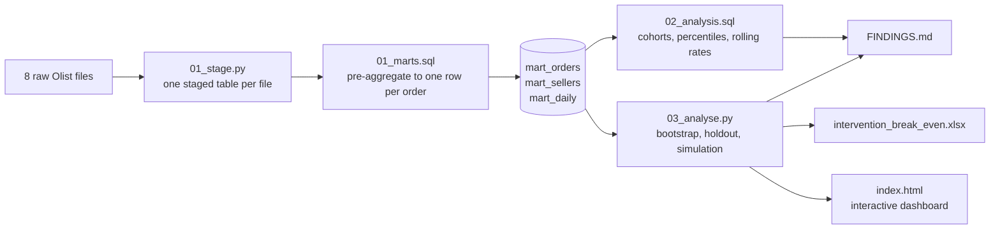

<div align="center">

# Marketplace Delivery Reliability and Seller Intervention

**Where do delivery promises fail, and which interventions deserve an operations manager's limited attention?**

SQL marts, Python statistics, an Excel break-even model and an interactive dashboard on 94,819 delivered orders from the Olist marketplace.




</div>

## Contents

[The answer in one minute](#the-answer-in-one-minute) · [The dashboard](#the-dashboard) · [How it works](#how-it-works) · [Methods](#methods) · [Run it yourself](#run-it-yourself) · [Limitations](#limitations)

## The answer in one minute

| | Finding | So what |
|---|---|---|
| 🚚 | **72% of late orders are transit caused.** The seller handed over on time and the carrier lost the days. | Most lateness is not a seller problem. |
| 📈 | Late rate jumped from 4.5% to 15.2% in three spike months. **Under 8% of that rise came from a change in category, lane or seller mix.** | The same mix arrived later. Look at carrier capacity, not at who sold what. |
| ⚖️ | The top 5% of sellers hold 58.5% of late orders, **but they also ship 49.6% of all orders.** | Concentration is mostly size. A "worst sellers" list is mostly a "biggest sellers" list. |
| 🔁 | Sellers flagged for a high late rate were **no worse than everyone else** in the following five months (4.0% against 4.6%). | Penalising them would punish noise. |
| ⏱️ | Sellers flagged for **missing dispatch deadlines** stayed worse (13.1% against 7.1%). 12 lanes also stayed worse. | These two are real, persistent and worth a bounded pilot. |
| 💰 | A longer promise on the 12 lanes removes about 254 late orders a year. Coaching 30 sellers removes about 30. | Test the lane change first. Keep any seller pilot small, cheap and supportive. |

Full write up: **[FINDINGS.md](FINDINGS.md)**

## The dashboard

Open `index.html` through a local server (see [Run it yourself](#run-it-yourself)). Light theme, three tabs, every view responds to the filters.

<details open>
<summary><b>1. Reliability scorecard</b></summary>

<br>

Six KPI tiles with interval estimates, late rate by month split into dispatch and transit causes, a mix against performance breakdown, and late orders by lane, destination and category. Click a bar to filter.



</details>

<details>
<summary><b>2. Seller drill through</b></summary>

<br>

Concentration curve, an interval chart of observed against expected late rate, and a sortable scorecard with a minimum volume slider. Click any seller for a monthly trend against the platform, where their late orders go, and a recommendation.



</details>

<details>
<summary><b>3. Recommendation queue and pilot simulator</b></summary>

<br>

Holdout evidence for each kind of flag, a ranked queue of lanes and sellers with the action for each, and sliders for pilot size, coaching effect and costs that recalculate avoided late orders, net benefit and break-even.



</details>

## How it works



| Layer | File | What it does |
|---|---|---|
| Stage | [`pipeline/01_stage.py`](pipeline/01_stage.py) | Loads orders, items, sellers, payments, customers, reviews and products as separate tables. No joins. |
| Marts | [`sql/01_marts.sql`](sql/01_marts.sql) | Grain safe order mart, seller mart, daily mart with a 28 day rolling late rate |
| Validation | [`pipeline/02_build_marts.py`](pipeline/02_build_marts.py) | Seven checks that stop the build, including value reconciliation against staging |
| SQL analysis | [`sql/02_analysis.sql`](sql/02_analysis.sql) | Scorecard, percentile delays, Pareto, lanes, seller cohorts, review impact |
| Statistics | [`pipeline/03_analyse.py`](pipeline/03_analyse.py) | Mix decomposition, bootstrap intervals, fair flagging, holdout test, pilot simulation |
| Query plans | [`docs/query_plans.md`](docs/query_plans.md) | Before and after for the drill through query |
| Excel | [`excel/intervention_break_even.xlsx`](excel/intervention_break_even.xlsx) | Live formula model: seller pilot, lane promise, sensitivity grid |
| Dashboard | [`index.html`](index.html) | Scorecard, drill through, recommendation queue, simulator |

## Methods

<details>
<summary><b>Grain safe joins</b></summary>

<br>

Order items (112,650 rows), payments (103,886) and reviews (99,224) each have more rows than orders (98,666 with items). Joining them directly to orders multiplies rows and double counts value. Each child table is aggregated to one row per order first, then joined. The build proves it: item value and payment value in the mart reconcile to staging to the cent.

For the 1,220 orders with more than one seller, the order is assigned to the seller with the highest item value.

</details>

<details>
<summary><b>Cause of a late order</b></summary>

<br>

- **Dispatch:** the carrier received the parcel after the seller's shipping limit.
- **Transit:** the seller met the limit and the order still arrived after the estimate.

</details>

<details>
<summary><b>Fair seller flagging</b></summary>

<br>

Three rules, all required:

1. **Minimum volume:** 30 delivered orders. 2,313 sellers fall below it and are not judged; 224 of them have a late rate of 25% or more on a handful of orders.
2. **Interval, not point estimate:** the lower bound of the 95% Wilson interval must clear the benchmark.
3. **Expected rate:** the benchmark is what the seller's own order mix predicts, using the platform late rate for each order's month and destination state. This cleared 32 of the 83 sellers a naive rule would flag.

</details>

<details>
<summary><b>Holdout test</b></summary>

<br>

Flags were set on orders to February 2018 and judged on April to August 2018. Picking the worst performers and assuming they stay bad overstates any intervention, because extreme results drift back toward average. The holdout measures how much of the gap is real.

</details>

<details>
<summary><b>Example: percentile delays with window functions</b></summary>

```sql
WITH r AS (
    SELECT excess_days, PERCENT_RANK() OVER (ORDER BY excess_days) AS p
    FROM mart_orders WHERE is_late
)
SELECT (SELECT MIN(excess_days) FROM r WHERE p >= 0.50) AS p50,
       (SELECT MIN(excess_days) FROM r WHERE p >= 0.90) AS p90,
       (SELECT MIN(excess_days) FROM r WHERE p >= 0.95) AS p95;
```

</details>

## Run it yourself

Python 3.10 or newer with `pandas`, `numpy` and `openpyxl`.

```bash
pip install pandas numpy openpyxl
python pipeline/01_stage.py             # downloads the raw files and stages them
python pipeline/02_build_marts.py       # builds marts and runs validation
python pipeline/03_analyse.py           # SQL analysis, statistics, query plans
python pipeline/04_workbook.py          # Excel break-even model
python pipeline/05_export_dashboard.py  # dashboard data
python -m http.server                   # then open http://localhost:8000
```

## Limitations

- **Costs are placeholders.** Olist does not publish support, refund or coaching costs. Every cost in the workbook and simulator is an assumption to replace.
- **The coaching effect is unknown.** The simulation draws it from 15% to 50%. Measuring it is the purpose of the pilot.
- **The promise change assumes no behaviour change.** A longer promise can reduce orders. The workbook includes that as an input, and it needs an A/B test.
- **The dataset is a sample** of roughly 100,000 orders over two years, so absolute counts are small. Rates and rankings carry over; totals scale with volume.
- **No BI file.** The brief named Power BI; the scorecard, drill through and queue are built as a web dashboard so anyone can open them without a licence.
- Analysis covers delivered orders only. Cancelled and undelivered orders are out of scope.

## Data source

[Olist Brazilian E-Commerce Public Dataset](https://github.com/olist/work-at-olist-data), published by Olist. Orders purchased January 2017 to August 2018.

<div align="center">

Built by **Sidhant Pujara** · [LinkedIn](https://linkedin.com/in/sidhant-pujara) · [Portfolio](https://sidhantpujara.vercel.app)

</div>
